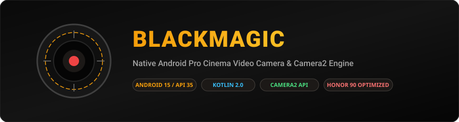
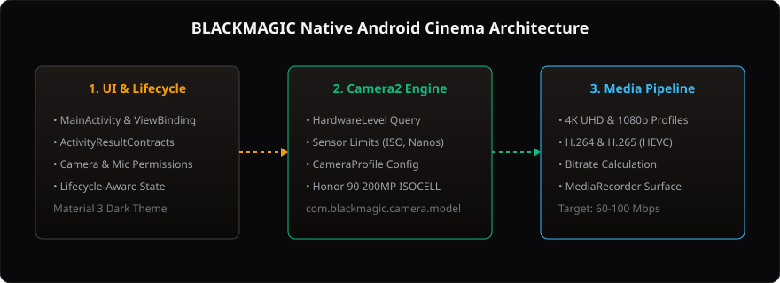

<div align="center">



# BLACKMAGIC — Professional Android Video Camera

**A native Android manual video recording application inspired by cinema camera interfaces and manual monitoring tools, engineered for modern Android 15 devices with specific tuning for the Honor 90.**

[](https://github.com/kamalesh404/BLACKMAGIC/actions/workflows/android-build.yml)
[-3DDC84?style=flat&logo=android&logoColor=white)](https://developer.android.com/)
[](https://kotlinlang.org/)
[](https://gradle.org/)
[](https://openjdk.org/)
[](LICENSE)

[Architecture](#-architecture) · [Target Device Specs](#-target-device-hardware-profile-honor-90) · [Feature Status](#-feature-implementation-status) · [Build Instructions](#-building--testing)

</div>

---

## 📖 Overview

**BLACKMAGIC** is a native Kotlin Android camera application designed to explore advanced video recording controls via the Android **Camera2 API**. Modeled after professional cinema camera workflows, the project provides granular control over video exposure parameters, tactile monitoring overlays, and reproducible build automation targeting **Android 15 (API 35)** with backward compatibility to Android 9.0 (API 28).

---

## 📱 Target Device Hardware Profile (Honor 90)

The application architecture is explicitly tuned around the Camera2 characteristics of the **Honor 90** (5G):

| Parameter | Specification | Camera2 Mapping |
|---|---|---|
| **SoC** | Qualcomm Snapdragon 7 Gen 1 Accelerated Edition (4nm) | High-throughput ISP & hardware HEVC encoder |
| **Main Sensor** | 200 MP Samsung ISOCELL HP3 (1/1.4", f/1.9) | 16-in-1 pixel binning yielding 12.5 MP default capture |
| **Hardware Level** | Camera2 `INFO_SUPPORTED_HARDWARE_LEVEL_FULL` | Full manual sensor & exposure parameter control |
| **Video Modes** | 4K UHD (3840×2160) @ 30 fps, 1080p @ 30/60 fps | High-bitrate H.264 and H.265 (HEVC) streams |
| **Operating System** | MagicOS 8.0 / Android 14 / Android 15 preview | Strict runtime permissions & scoped storage |

---

## 🚦 Feature Implementation Status

To ensure complete technical truthfulness, project features are explicitly categorized by verification state:

### ✅ Implemented & Verified in Code
- **Modern Build System:** Gradle 8.11.1 with Android Gradle Plugin 8.7.3 and Kotlin 2.0.21 on Java 21 LTS.
- **Permission Pipeline:** Robust runtime permission negotiation (`ActivityResultContracts`) for `CAMERA` and `RECORD_AUDIO`.
- **Camera Capabilities Domain Model:** Strict validation and boundary-clamping models for sensor ISO, shutter speed (nanoseconds), and codec bitrate efficiency (`H.264` vs `H.265`).
- **Unit Testing Suite:** Automated unit tests verifying hardware level parsing, resolution aspect ratios, and bitrate calculations.
- **CI/CD Automation:** GitHub Actions workflow executing wrapper validation, compilation, test suites, and debug APK artifact generation.

### 🟡 Architecture & Capture Pipeline (Phase D Roadmap)
- Camera2 `CameraDevice.StateCallback` and `CameraCaptureSession` lifecycle managers.
- SurfaceView and TextureView high-framerate viewfinder integration.
- Manual ISO slider and exposure compensation controls (`CONTROL_AE_MODE_OFF`).
- Manual focus distance override (`CONTROL_AF_MODE_OFF` & `LENS_FOCUS_DISTANCE`).
- Cinema aspect ratio guide lines (2.39:1 anamorphic, 16:9 broadcast).
- Audio level metering using `MediaRecorder` or `AudioRecord` amplitude streams.

---

## 🏗️ Architecture

```
BLACKMAGIC/
├── .github/workflows/
│   └── android-build.yml        # Automated CI: wrapper check, unit tests, APK build
├── app/
│   ├── build.gradle.kts         # App module build definition (SDK 35, ViewBinding)
│   ├── proguard-rules.pro       # Code shrinking & obfuscation rules
│   └── src/
│       ├── main/
│       │   ├── AndroidManifest.xml # Camera and audio permission declarations
│       │   ├── java/com/blackmagic/camera/
│       │   │   ├── MainActivity.kt # Lifecycle & permission coordinator
│       │   │   └── model/
│       │   │       └── CameraCapabilities.kt # Camera2 domain models & bitrate calculator
│       │   └── res/             # Material 3 dark cinema theme and layouts
│       └── test/java/com/blackmagic/camera/
│           ├── CameraCapabilitiesTest.kt # Domain model unit tests
│           └── ExampleUnitTest.kt        # Foundation sanity checks
├── gradle/libs.versions.toml    # Centralized Gradle version catalog
├── build.gradle.kts             # Root build script
├── settings.gradle.kts          # Plugin repositories & module declarations
└── gradlew / gradlew.bat        # Pinned Gradle wrapper
```

<div align="center">
  
</div>

---

## 🛠️ Building & Testing

### Prerequisites
- **JDK:** OpenJDK 21 LTS or Microsoft OpenJDK 21.
- **Android SDK:** Platforms 28 through 35 with build-tools 35.0.0.

### Local Build Commands

1. **Verify Gradle Wrapper:**
   ```bash
   ./gradlew --version
   ```

2. **Execute Unit Tests:**
   ```bash
   ./gradlew testDebugUnitTest
   ```

3. **Assemble Debug APK:**
   ```bash
   ./gradlew assembleDebug
   ```
   The compiled APK will be located at:
   `app/build/outputs/apk/debug/app-debug.apk`

---

## ☁️ Continuous Integration & Releases

Every push or pull request to the `main` branch triggers the GitHub Actions workflow at [`.github/workflows/android-build.yml`](.github/workflows/android-build.yml):
1. Validates the SHA-256 checksum of the Gradle wrapper binary.
2. Provisions Java 21 and pre-installed Android SDK 35 on an Ubuntu runner.
3. Compiles and runs all Kotlin unit tests.
4. Builds the signed Debug APK and publishes it as a downloadable CI artifact retained for 14 days.

---

## 📄 License

This project is licensed under the [MIT License](LICENSE).
